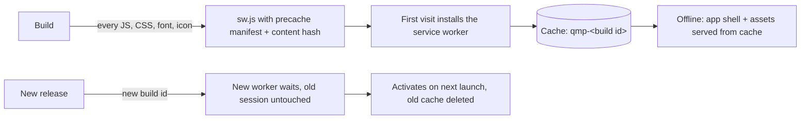

<div align="center">


# R.J QUIZ — Quiz Master Pro

**Offline-first quizzes, flashcards, notes and revision analytics for serious exam preparation.**
Install it as a web app or as an Android APK. Open it anywhere, with or without internet.

[](https://github.com/therjmali/quiz-master-pro/actions/workflows/ci.yml)
[](https://github.com/therjmali/quiz-master-pro/actions/workflows/pages.yml)
[](https://github.com/therjmali/quiz-master-pro/actions/workflows/android.yml)
[](https://github.com/therjmali/quiz-master-pro/releases/latest)

[**Open the web app**](https://therjmali.github.io/quiz-master-pro/) · [**Download the APK**](https://github.com/therjmali/quiz-master-pro/releases/latest) · [Changelog](CHANGELOG.md)

</div>

---

## Get it

| Platform | How |
| --- | --- |
| **Android** | Download `RJ-QUIZ-vX.Y.Z.apk` from the [latest release](https://github.com/therjmali/quiz-master-pro/releases/latest), open it, and allow *Install unknown apps* for your browser or file manager when Android asks. |
| **Any browser / iPhone / desktop** | Open the [web app](https://therjmali.github.io/quiz-master-pro/), then *Install app* (Chrome/Edge) or *Share → Add to Home Screen* (Safari). After the first visit it works offline. |

Every release APK is built by GitHub Actions and only published after it passes type-checking, repository
verification, APK inspection (package id, version, bundled web app, signature) and a boot test on a real Android
emulator, including a cold start in airplane mode. Each release lists the file's SHA-256 so you can check your download.

## What's inside

- **Quiz engine** — timed and untimed sessions, negative marking, review with rationales, per-question difficulty ratings and disputes.
- **Flashcards & spaced repetition** — bookmark questions, revise them as cards, get due-for-review nudges.
- **Practice & mastery tracking** — weak-question panels, practice goals, session comparisons, mastery heat-maps.
- **Analytics** — streaks, time-of-day performance, radar by subject, confidence charts, exam-readiness and score prediction.
- **Library** — folders and subjects, bulk import of question sets, quiz export/import and local backups.
- **Planning** — exam countdowns, study calendar, daily challenge.
- **Notes & reports** — rich-text notes, printable revision sheets and result reports.
- **Sign-in window & accessibility zoom** — sign in or create an account from one window opened from the header or dashboard; *Settings → Accessibility* zooms the whole app 70–150 % (also Ctrl/Cmd + `+` / `-` / `0`).
- **Account & cloud sync** — optional sign-in (Supabase) that keeps history, library, bookmarks, mistakes, flashcards and settings identical across devices, with a safe first-sign-in choice, restore points and a readable sync log. [Setup guide](docs/CLOUD_SETUP.md).
- **Automatic backups** — scheduled, checksummed snapshots with rotation, restore (with a safety copy), export to file and import.
- **Smart reminders** — real Android notifications for daily study, due cards, streak saver, exam countdown and a weekly summary, with quiet hours.
- **AI on your device** — bring your own Gemini, Claude, OpenAI or Cohere key; quiz generation, AI tutor chat, photo-to-quiz OCR, 7-day study plans, revision notes, question verification and explanations all run directly from your device with no server.
- **Data & Trash** — deleted library items and quiz results are restorable for 30 days (and sync), storage meter, data check.
- **App icon, widgets & device** — custom app icon, install controls, and 4 Android home-screen widgets (Study Stats, Quick Actions, Subject Mastery, Exam Countdown) wired to your live data.
- **Reports** — *Progress*, *Notes*, *Bookmarks* and the results screen make PDF / Word / text / web reports on your device (no internet, no server) in a clean numbered Q&A format with explanations, one or two columns, preview full screen, saved to Downloads / R.J QUIZ with a notification. Tune them in *Settings → Reports & downloads*.
- **Drafts** — leaving a quiz saves it (last 5, one per quiz) and drafts sync to your other devices; the full question data of finished quizzes syncs too, so every device can open every quiz.
- **In-app updates** — *Settings → App updates* downloads the new APK inside the app with live progress, verifies it and opens Android's installer. No browser, no manual download.
- **Progress** — the bottom *Progress* tab is your lifetime score, report and overview, with a rank meter and live cloud / backup / storage / app status. Everything else lives in **Settings**, opened from your profile photo at the top right.
- **Optional legacy backend only:** e-mailed reports (`emailQuizReport`). Everything else works standalone in the PWA and APK.

### Works offline vs. needs a connection

The app is local-first: history, bookmarks, notes, settings and imported question sets live in the browser's
IndexedDB / localStorage on your device.

| Works with no network | Needs internet | Needs the optional legacy backend |
| --- | --- | --- |
| Opening and installing the app, all screens, fonts and icons | Cloud sync and sign-in (Supabase) | E-mailed reports |
| Taking quizzes from imported or pasted question sets (incl. RFC-4180 CSV) | AI tutor, quiz generation, photo OCR, study plans & explanations (your own key, straight to your provider) | |
| History, bookmarks, flashcards, spaced repetition, analytics, calendar | Checking for / downloading in-app APK updates (GitHub Releases) | |
| PDF / Word / HTML / text reports, notes, automatic backups, export/import, trash & restore | | |
| Android reminders, notifications and home-screen widgets | | |

Without an AI key or a cloud project, those features simply say what is needed; nothing else is affected.

## How the offline mode works



- **Web:** `build/vite-plugins.ts` stamps `build/sw.template.js` with the exact list of files in the build and a hash of
  their contents. Pages are network-first with a short timeout and fall back to the cached app shell; static files are
  cache-first; `/api/` calls and cross-origin requests are never intercepted.
- **Android:** [Capacitor](https://capacitorjs.com/) bundles the same `dist/` folder inside the APK and serves it from the
  device (`https://localhost`). No website is ever loaded, and no service worker is needed.
- **Fonts** (Plus Jakarta Sans, DM Sans, Syne, JetBrains Mono) are bundled via `@fontsource`; there are no requests to Google.

## Develop

Requirements: Node.js 20+ (22 recommended). For the Android build also JDK 21 and the Android SDK (CI provides both).

```bash
npm ci                 # install
npm run dev            # dev server on http://localhost:8080
npm run build          # type-check + production build into dist/
npm run preview        # serve dist/ locally (use VITE_BASE=/ for the root)

npm run verify         # typecheck + build + repository checks + build-output checks
npm run test:unit      # 46+ unit tests: sync engine, merge, backups, trash, reminders, AI (TypeScript, no browser)
npm run test:sql       # applies supabase/quiz_schema.sql twice to a throw-away PostgreSQL and runs 14 behavioural tests
npm run test:offline   # real-Chrome test: install SW, go offline, reload, deep link (needs Chrome)
```

### Scripts

| Script | Purpose |
| --- | --- |
| `npm run verify:repo` | Checks required files, manifest and icon dimensions, Android resources, workflows, `.gitignore`, and scans for leaked secrets |
| `npm run verify:dist` | Checks the build: no remote scripts/styles, SPA fallback, precache covers every file, service worker stamped |
| `npm run test:offline` | Headless Chrome offline test, screenshots in `test-results/` |
| `scripts/android-prepare.sh` | Generates the native project, branding, version numbers |
| `scripts/verify-apk.sh` | Static APK inspection (used by CI) |
| `scripts/emulator-smoke.sh` | Install/launch/offline-start test on an emulator (used by CI) |
| `scripts/generate-icons.py` | Regenerates all icons (`pip install pillow`) |

## Build the Android APK

**In GitHub (recommended):** push a version tag. The workflow builds, signs, verifies, emulator-tests and publishes a release.

```bash
# bump "version" in package.json and add a CHANGELOG entry first, then:
git tag v1.0.1 && git push origin v1.0.1
```

You can also run **Actions → Build Android APK → Run workflow** to get the APK as a downloadable artifact without releasing.

**Locally:**

```bash
npm ci
VITE_BASE=/ npm run build:fast
bash scripts/android-prepare.sh 1.0.0 1       # versionName versionCode
cd android && ./gradlew assembleRelease        # APK in app/build/outputs/apk/release/
```

### Signing

Without secrets the workflow signs with a throw-away debug key: the APK installs fine, but a later build can't update it
in place (Android requires the same key). To ship updatable builds, create a keystore once and store it as secrets:

```bash
keytool -genkeypair -keystore release.keystore -alias quizmaster -keyalg RSA -keysize 2048 -validity 36500
base64 -w0 release.keystore | gh secret set ANDROID_KEYSTORE_B64
gh secret set ANDROID_KEYSTORE_PASSWORD      # the keystore (and key) password
gh secret set ANDROID_KEY_ALIAS              # optional, defaults to "quizmaster"
```

Keep `release.keystore` somewhere safe and **never commit it** — losing it means users can't update in place.

**Status:** the repository secrets are set (from v2.5.0 every release is signed with the same permanent key), so new
versions install over the old one and keep your data. APKs from **before v2.5.0** were signed with a different
throw-away key each time; Android reports *"App not installed as package conflicts with an existing package"* when you
try to update one of those. Fix once: back up in the app (profile photo → Settings → Backups), uninstall the old copy, install the new APK,
restore. After that, updates install in place.

### In-app updates

Tap your profile photo (top right) → **Settings → App updates** (a dot on the photo and a strip on the home screen
tell you when a new version exists). *Download & install* then:

1. downloads the APK from this repository's GitHub Releases only (https, `github.com/therjmali/quiz-master-pro/releases/download/…`) with a live progress bar;
2. verifies it on the device — SHA-256 fingerprint (when the release publishes one), package name, a higher version number and the **same signing key** as the installed app;
3. opens Android's installer. Android always asks you to confirm; that step cannot be skipped by any app. The first time, Android also asks you to allow installs from R.J QUIZ (the app opens that settings page for you).

The check runs quietly at most every 12 hours, only in the installed app, never blocks start-up and fails clearly when
offline. A leftover downloaded file is deleted on the next start. On the web / installed PWA, updates apply through the
service worker (*Update & reload*). If something goes wrong the panel shows the reason and a link to the release page.

## Navigation

| Where | What |
| --- | --- |
| **Bottom bar** | Home · Library · Create · Stats · **Progress** (lifetime score, report, overview) |
| **Profile photo, top right** | **Settings**: account card (photo, name, emoji, sign-in), quick jumps (updates, cloud, backups, trash), then every setting (appearance, quiz & study, AI, backups, data & trash, notifications, reminders, gestures, cloud, device, advanced), plus Awards, AI notes, templates and API keys |

The profile photo is stored on the device as a small cropped JPEG (no server needed), so it works offline.

## Configuration

| Name | Where | Purpose |
| --- | --- | --- |
| `VITE_BASE` | env | Base path. `/` locally and for the APK; `/<repo>/` on GitHub Pages (set by CI) |
| `SUPABASE_URL`, `SUPABASE_ANON_KEY` | repository **variables** | Cloud sync + sign-in. The anon key is public by design; never use a `service_role` key. See [docs/CLOUD_SETUP.md](docs/CLOUD_SETUP.md) |
| `ZITE_RUNNER_URL` | repository **variable** | Optional legacy backend for OCR / PDF / e-mail endpoints |
| `ANDROID_KEYSTORE_B64`, `ANDROID_KEYSTORE_PASSWORD`, `ANDROID_KEY_ALIAS` | repository **secrets** | Release signing (optional) |
| `BACKUP_REPORT_CC` | backend env | Optional CC address for backup-report e-mails |

See [`.env.example`](.env.example).

## Project structure

```
src/                 React + TypeScript app (components, hooks, utils, stores)
src/platform/        Accounts, cloud sync engine, auto backups, reminders, on-device AI, app icon, PWA plumbing
src/api/             Endpoint definitions for the optional legacy backend (OCR, PDF, e-mail)
supabase/            quiz_schema.sql (cloud tables, RLS, functions) and its SQL tests
tests/               Unit tests (npm run test:unit)
docs/                CLOUD_SETUP.md
packages/components/ Shared UI primitives
public/              Manifest, favicon, icons (copied as-is into the build)
build/               Vite plugins and the service-worker template
android-res/         Launcher icons and colours applied to the generated Android project
scripts/             Verification, icon generation and Android helper scripts
.github/workflows/   ci.yml (Verify) · pages.yml (web) · android.yml (APK + release)
```

The `android/` project is generated fresh by `scripts/android-prepare.sh` and is intentionally not committed.

## Troubleshooting

| Symptom | Fix |
| --- | --- |
| Web app shows old version after a release | Close all tabs/the installed app and reopen once; the new service worker activates on the next launch |
| "App not installed" on Android | Uninstall any earlier build signed with a different key, then install again |
| "Cloud database is not set up yet" | Run `supabase/quiz_schema.sql` once in your Supabase SQL editor ([guide](docs/CLOUD_SETUP.md)) |
| AI says it needs a key | Settings -> AI & Content -> *AI on this device*, paste a key, press *Test key* |
| Reminders do not arrive on Android | Allow notifications for the app; reminders refresh each time you open it |
| Pages shows a 404 | Repository **Settings → Pages → Source: GitHub Actions**, then re-run *Deploy web app* |

## Licence

No licence file is included yet, so all rights are reserved by the author by default. Add a `LICENSE` file if you want others to be able to reuse the code.
