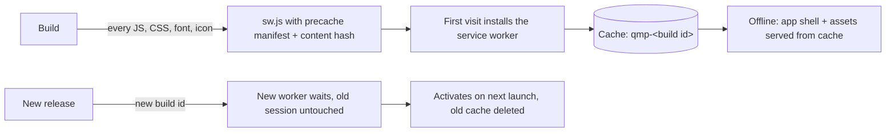

<div align="center">


# R.J QUIZ — Quiz Master Pro

**Offline-first quizzes, flashcards, notes and revision analytics for serious exam preparation.**
Install it as a web app or as an Android APK. Open it anywhere, with or without internet.

[](https://github.com/therjmali/quiz-master-pro/actions/workflows/ci.yml)
[](https://github.com/therjmali/quiz-master-pro/actions/workflows/pages.yml)
[](https://github.com/therjmali/quiz-master-pro/actions/workflows/android.yml)
[](https://github.com/therjmali/quiz-master-pro/releases/latest)

[**Open the web app**](https://therjmali.github.io/quiz-master-pro/) · [**Download the APK**](https://github.com/therjmali/quiz-master-pro/releases/latest) · [Changelog](CHANGELOG.md)

</div>

---

## Get it

| Platform | How |
| --- | --- |
| **Android** | Download `RJ-QUIZ-vX.Y.Z.apk` from the [latest release](https://github.com/therjmali/quiz-master-pro/releases/latest), open it, and allow *Install unknown apps* for your browser or file manager when Android asks. |
| **Any browser / iPhone / desktop** | Open the [web app](https://therjmali.github.io/quiz-master-pro/), then *Install app* (Chrome/Edge) or *Share → Add to Home Screen* (Safari). After the first visit it works offline. |

Every release APK is built by GitHub Actions and only published after it passes type-checking, repository
verification, APK inspection (package id, version, bundled web app, signature) and a boot test on a real Android
emulator, including a cold start in airplane mode. Each release lists the file's SHA-256 so you can check your download.

## What's inside

- **Quiz engine** — timed and untimed sessions, negative marking, review with rationales, per-question difficulty ratings and disputes.
- **Flashcards & spaced repetition** — bookmark questions, revise them as cards, get due-for-review nudges.
- **Practice & mastery tracking** — weak-question panels, practice goals, session comparisons, mastery heat-maps.
- **Analytics** — streaks, time-of-day performance, radar by subject, confidence charts, exam-readiness and score prediction.
- **Library** — folders and subjects, bulk import of question sets, quiz export/import and local backups.
- **Planning** — exam countdowns, study calendar, daily challenge.
- **Notes & reports** — rich-text notes, printable revision sheets and result reports.
- **Online extras** (need a backend, see below) — AI quiz/notes generation, explanations, photo-to-quiz OCR, cloud history sync, e-mailed reports.

### Works offline vs. needs a connection

The app is local-first: history, bookmarks, notes, settings and imported question sets live in the browser's
IndexedDB / localStorage on your device.

| Works with no network | Needs the hosted backend |
| --- | --- |
| Opening and installing the app, all screens, fonts and icons | AI generation, explanations and chat |
| Taking quizzes from imported or pasted question sets | Photo-to-quiz OCR |
| History, bookmarks, flashcards, spaced repetition, analytics, calendar | E-mail reports, PDF generation, cloud sync |
| Notes, local backup/export and import | Sign-in |

Without a backend the online features simply report that they are unavailable; nothing else is affected.
To connect a backend, set the repository variable `ZITE_RUNNER_URL` (see [Configuration](#configuration)).

## How the offline mode works



- **Web:** `build/vite-plugins.ts` stamps `build/sw.template.js` with the exact list of files in the build and a hash of
  their contents. Pages are network-first with a short timeout and fall back to the cached app shell; static files are
  cache-first; `/api/` calls and cross-origin requests are never intercepted.
- **Android:** [Capacitor](https://capacitorjs.com/) bundles the same `dist/` folder inside the APK and serves it from the
  device (`https://localhost`). No website is ever loaded, and no service worker is needed.
- **Fonts** (Plus Jakarta Sans, DM Sans, Syne, JetBrains Mono) are bundled via `@fontsource`; there are no requests to Google.

## Develop

Requirements: Node.js 20+ (22 recommended). For the Android build also JDK 21 and the Android SDK (CI provides both).

```bash
npm ci                 # install
npm run dev            # dev server on http://localhost:8080
npm run build          # type-check + production build into dist/
npm run preview        # serve dist/ locally (use VITE_BASE=/ for the root)

npm run verify         # typecheck + build + repository checks + build-output checks
npm run test:offline   # real-Chrome test: install SW, go offline, reload, deep link (needs Chrome)
```

### Scripts

| Script | Purpose |
| --- | --- |
| `npm run verify:repo` | Checks required files, manifest and icon dimensions, Android resources, workflows, `.gitignore`, and scans for leaked secrets |
| `npm run verify:dist` | Checks the build: no remote scripts/styles, SPA fallback, precache covers every file, service worker stamped |
| `npm run test:offline` | Headless Chrome offline test, screenshots in `test-results/` |
| `scripts/android-prepare.sh` | Generates the native project, branding, version numbers |
| `scripts/verify-apk.sh` | Static APK inspection (used by CI) |
| `scripts/emulator-smoke.sh` | Install/launch/offline-start test on an emulator (used by CI) |
| `scripts/generate-icons.py` | Regenerates all icons (`pip install pillow`) |

## Build the Android APK

**In GitHub (recommended):** push a version tag. The workflow builds, signs, verifies, emulator-tests and publishes a release.

```bash
# bump "version" in package.json and add a CHANGELOG entry first, then:
git tag v1.0.1 && git push origin v1.0.1
```

You can also run **Actions → Build Android APK → Run workflow** to get the APK as a downloadable artifact without releasing.

**Locally:**

```bash
npm ci
VITE_BASE=/ npm run build:fast
bash scripts/android-prepare.sh 1.0.0 1       # versionName versionCode
cd android && ./gradlew assembleRelease        # APK in app/build/outputs/apk/release/
```

### Signing

Without secrets the workflow signs with a throw-away debug key: the APK installs fine, but a later build can't update it
in place (Android requires the same key). To ship updatable builds, create a keystore once and store it as secrets:

```bash
keytool -genkeypair -keystore release.keystore -alias quizmaster -keyalg RSA -keysize 2048 -validity 36500
base64 -w0 release.keystore | gh secret set ANDROID_KEYSTORE_B64
gh secret set ANDROID_KEYSTORE_PASSWORD      # the keystore (and key) password
gh secret set ANDROID_KEY_ALIAS              # optional, defaults to "quizmaster"
```

Keep `release.keystore` somewhere safe and **never commit it** — losing it means users can't update in place.

## Configuration

| Name | Where | Purpose |
| --- | --- | --- |
| `VITE_BASE` | env | Base path. `/` locally and for the APK; `/<repo>/` on GitHub Pages (set by CI) |
| `ZITE_RUNNER_URL` | repository **variable** | Optional hosted backend for the online-only features, baked into the web app and APK builds |
| `ANDROID_KEYSTORE_B64`, `ANDROID_KEYSTORE_PASSWORD`, `ANDROID_KEY_ALIAS` | repository **secrets** | Release signing (optional) |
| `BACKUP_REPORT_CC` | backend env | Optional CC address for backup-report e-mails |

See [`.env.example`](.env.example).

## Project structure

```
src/                 React + TypeScript app (components, hooks, utils, stores)
src/api/             Server endpoint definitions for the optional backend (AI, e-mail, PDF, sync)
packages/components/ Shared UI primitives
public/              Manifest, favicon, icons (copied as-is into the build)
build/               Vite plugins and the service-worker template
android-res/         Launcher icons and colours applied to the generated Android project
scripts/             Verification, icon generation and Android helper scripts
.github/workflows/   ci.yml (Verify) · pages.yml (web) · android.yml (APK + release)
```

The `android/` project is generated fresh by `scripts/android-prepare.sh` and is intentionally not committed.

## Troubleshooting

| Symptom | Fix |
| --- | --- |
| Web app shows old version after a release | Close all tabs/the installed app and reopen once; the new service worker activates on the next launch |
| "App not installed" on Android | Uninstall any earlier build signed with a different key, then install again |
| Online features say they are unavailable | Expected without a backend — set `ZITE_RUNNER_URL` and re-run the workflows |
| Pages shows a 404 | Repository **Settings → Pages → Source: GitHub Actions**, then re-run *Deploy web app* |

## Licence

No licence file is included yet, so all rights are reserved by the author by default. Add a `LICENSE` file if you want others to be able to reuse the code.
